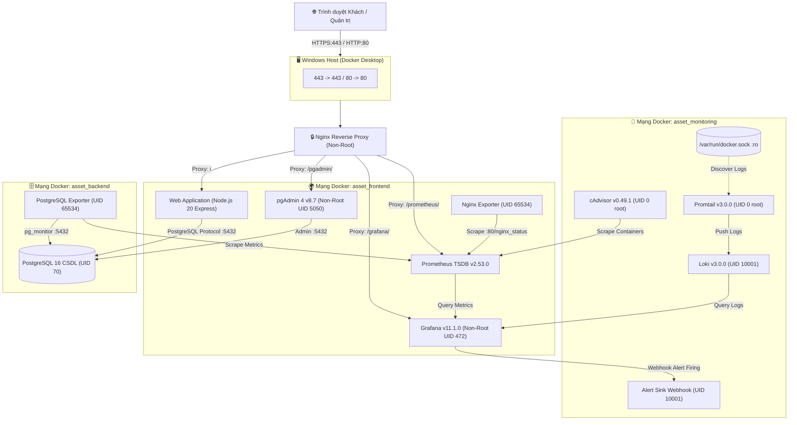

<p align="center">
  <h1 align="center">🏢 Hệ thống Quản lý Tài sản & Thiết bị</h1>
  <p align="center">
    <strong>Asset & Equipment Management System</strong>
  </p>
  <p align="center">
    Nền tảng web toàn diện phục vụ quản lý trang thiết bị CNTT chuyên nghiệp —<br/>
    tích hợp giám sát hiệu năng, log tập trung và cảnh báo an ninh thời gian thực.
  </p>
</p>

<p align="center">
  
  
  
  
  
  
  
</p>

<p align="center">
  
  
  
  
</p>

---

> **Học phần:** Triển khai và Quản trị Hệ thống Phần mềm
> **MSSV:** DTC245180061 · **Họ và tên:** Nguyễn Minh Lượng
> **Repository:** `Thi_Trien_Khai` · **Nhánh:** `main`

---

## 📑 Mục lục

- [1. Giới thiệu dự án](#-1-giới-thiệu-dự-án)
- [2. Công nghệ sử dụng](#-2-công-nghệ-sử-dụng)
- [3. Sơ đồ Kiến trúc Hệ thống](#-3-sơ-đồ-kiến-trúc-hệ-thống)
- [4. Yêu cầu Hệ thống](#-4-yêu-cầu-hệ-thống)
- [5. Cài đặt và Khởi chạy Nhanh](#-5-cài-đặt-và-khởi-chạy-nhanh)
- [6. Địa chỉ Truy cập & Tài khoản Mẫu](#-6-địa-chỉ-truy-cập--tài-khoản-mẫu)
- [7. Hướng dẫn Sử dụng theo Vai trò](#-7-hướng-dẫn-sử-dụng-theo-vai-trò)
- [8. Giám sát Hiệu năng (Prometheus + Grafana)](#-8-giám-sát-hiệu-năng-prometheus--grafana)
- [9. Log tập trung (Loki + Promtail)](#-9-log-tập-trung-loki--promtail)
- [10. Kịch bản Sự cố An ninh (Brute Force)](#-10-kịch-bản-sự-cố-an-ninh-brute-force)
- [11. Hardening Bảo mật](#-11-hardening-bảo-mật)
- [12. Quản trị Vận hành & Sao lưu](#-12-quản-trị-vận-hành--sao-lưu)
- [13. Xử lý Sự cố (Troubleshooting)](#-13-xử-lý-sự-cố-troubleshooting)
- [14. Cấu trúc Thư mục](#-14-cấu-trúc-thư-mục)

---

## 📋 1. Giới thiệu dự án

Hệ thống **Quản lý Tài sản / Thiết bị** là nền tảng web phục vụ các đơn vị, cơ quan, phòng ban trường học quản lý trang thiết bị công nghệ thông tin chuyên nghiệp (máy tính, máy chiếu, thiết bị mạng, công cụ kỹ thuật).

### Tính năng nổi bật theo vai trò

| Vai trò | Chức năng chính |
| :--- | :--- |
| 👤 **Nhân viên** *(Employee)* | Duyệt danh sách thiết bị kèm hình ảnh trực quan · Tìm kiếm theo danh mục/vị trí · Tạo phiếu mượn có thời hạn (tối đa 30 ngày, 5 thiết bị/phiếu) · Quản lý phiếu mượn cá nhân · Mở trang nhãn thiết bị có mã QR Base64 |
| 🔑 **Thủ kho** *(Manager)* | Xét duyệt / từ chối phiếu mượn · Bàn giao thiết bị khi người mượn nhận máy · Tiếp nhận trả thiết bị kèm ghi chú hiện trạng · Lập và quản lý phiếu bảo trì/sửa chữa |
| 🛡️ **Quản trị viên** *(Admin)* | Toàn quyền CRUD danh mục & vị trí · Upload ảnh thực tế · In tem QR Code kiểm kê · Quản trị tài khoản người dùng · Biểu đồ thống kê KPI thời gian thực |

---

## 🛠️ 2. Công nghệ sử dụng

| Tầng | Công nghệ | Phiên bản |
| :--- | :--- | :---: |
| **Frontend & Backend** | Node.js + Express | 20 LTS |
| **Cơ sở dữ liệu** | PostgreSQL | 16 |
| **Reverse Proxy** | Nginx (Non-Root) | Latest |
| **Containerization** | Docker + Docker Compose | v2+ |
| **Giám sát Metrics** | Prometheus | 2.53.0 |
| **Dashboard & Alert** | Grafana | 11.1.0 |
| **Log Aggregation** | Loki + Promtail | 3.0.0 |
| **Container Metrics** | cAdvisor | 0.49.1 |
| **DB Admin** | pgAdmin 4 | 8.7 |

---

## 🏗️ 3. Sơ đồ Kiến trúc Hệ thống



---

## 💻 4. Yêu cầu Hệ thống

| Thành phần | Yêu cầu |
| :--- | :--- |
| **Hệ điều hành** | Windows 10/11 với WSL2 (Ubuntu 22.04 LTS hoặc 24.04 LTS) |
| **Docker** | Docker Desktop for Windows (bật tích hợp WSL2 Integration) |
| **Docker Compose** | Phiên bản v2 trở lên (`docker compose version`) |
| **Công cụ khác** | OpenSSL, Git, Bash shell (trong WSL2) |
| **RAM** | Tối thiểu 4 GB trống |
| **Ổ đĩa** | Tối thiểu 10 GB khả dụng |

---

## 🚀 5. Cài đặt và Khởi chạy Nhanh

### 5.1 · Clone kho mã nguồn

```bash
git clone https://github.com/minhluong26102006-hub/Thi_Trien_Khai.git ~/asset
cd ~/asset
```

### 5.2 · Khởi tạo tệp cấu hình môi trường

```bash
cp .env.example .env
chmod 600 .env
```

> [!WARNING]
> Thay đổi tất cả mật khẩu mặc định trong `.env` trước khi chạy để đảm bảo an toàn thông tin (mật khẩu CSDL, Grafana, session secret).

### 5.3 · Sinh chứng chỉ SSL tự ký

```bash
./nginx/gen-cert.sh
chmod 644 nginx/certs/server.key nginx/certs/server.crt
```

### 5.4 · Khởi động toàn bộ hệ thống

```bash
# Khởi chạy và build tất cả 12 container ở chế độ chạy ngầm
docker compose up -d --build

# Kiểm tra trạng thái sẵn sàng
docker compose ps
```

> [!TIP]
> Đảm bảo tất cả **12 container** đều ở trạng thái `Up` hoặc `Up (healthy)` trước khi truy cập hệ thống.

---

## 🔗 6. Địa chỉ Truy cập & Tài khoản Mẫu

| Dịch vụ | URL | Giao thức | Tài khoản mẫu | Mật khẩu |
| :--- | :--- | :---: | :--- | :--- |
| 🌐 **Web Application** | `https://localhost/` | HTTPS · 443 | `admin` · `thukho01` · `nhanvien01` | Xem `.env` |
| 🗃️ **pgAdmin 4** | `https://localhost/pgadmin/` | HTTPS · 443 | `admin@asset.local` | Xem `.env` → `PGADMIN_DEFAULT_PASSWORD` |
| 📊 **Grafana** | `https://localhost/grafana/` | HTTPS · 443 | `admin` | Xem `.env` → `GRAFANA_ADMIN_PASSWORD` |
| 📈 **Prometheus** | `https://localhost/prometheus/` | HTTPS · 443 | *Không yêu cầu* | — |

> [!CAUTION]
> Mật khẩu thực tế được lưu trữ **duy nhất** trong tệp `.env` — tệp này **không bao giờ** được commit lên Git.

---

## 👥 7. Hướng dẫn Sử dụng theo Vai trò

<details>
<summary><strong>👤 7.1 · Nhân viên (Employee — <code>nhanvien01</code>)</strong></summary>

1. **Đăng nhập:** Truy cập `https://localhost/auth/login`, nhập username `nhanvien01` và mật khẩu.
2. **Tra cứu thiết bị:** Xem danh sách thiết bị CNTT tại `/assets`, lọc theo danh mục (Laptop, Máy chiếu, Mạng) và trạng thái.
3. **Tạo phiếu mượn:** Vào menu **Mượn thiết bị** (`/loans/create`), tích chọn thiết bị `available`, nhập mục đích mượn và ngày hẹn trả.
4. **Theo dõi phiếu mượn:** Kiểm tra danh sách phiếu cá nhân tại `/loans`, theo dõi trạng thái:
   `pending` → `approved` → `borrowed` → `returned`

> [!NOTE]
> **Quy định mượn trả:** Mỗi nhân viên tối đa **3 phiếu** đồng thời · Mỗi phiếu **1–5 thiết bị** · Thời hạn **1–30 ngày**.

</details>

<details>
<summary><strong>🔑 7.2 · Thủ kho / Quản lý (Manager — <code>thukho01</code>)</strong></summary>

1. **Duyệt phiếu mượn:** Vào danh sách `/loans`, kiểm tra chi tiết phiếu mượn trạng thái `pending`, bấm **Phê duyệt** hoặc **Từ chối** kèm lý do.
2. **Bàn giao thiết bị:** Khi người mượn đến nhận, bấm **Bàn giao** (`/loans/:id/handover`), hệ thống ghi nhận thời điểm và chuyển thiết bị sang `borrowed`.
3. **Nhận trả thiết bị:** Bấm **Nhận trả** (`/loans/:id/return`), ghi chú hiện trạng linh kiện (VD: *Hoạt động tốt, nguyên tem bảo hành*). Hệ thống phục hồi thiết bị về `available`.
4. **Quản lý bảo trì:** Vào menu `/maintenance`, tạo phiếu sửa chữa (`/maintenance/create`) ghi nhận chi phí và nội dung bảo dưỡng.

</details>

<details>
<summary><strong>🛡️ 7.3 · Quản trị viên (Admin — <code>admin</code>)</strong></summary>

- Toàn quyền thực hiện mọi chức năng của Thủ kho và Nhân viên.
- **Quản lý danh mục & vị trí:** Thêm, sửa, sắp xếp danh mục loại thiết bị và vị trí phòng máy, kho bãi.
- **Quản lý tài sản:** Thêm thiết bị mới kèm upload ảnh thực tế (lưu trữ trong volume `asset_web_uploads` với quyền non-root `node:1000`).
- **In tem nhãn QR Code:** Mở `/assets/:id/label` để in nhãn chứa mã QR Base64 phục vụ kiểm kê.
- **Theo dõi KPI:** Truy cập `/kpi` xem biểu đồ tỷ lệ tài sản theo phòng ban, danh sách thiết bị quá hạn mượn.

</details>

---

## 📊 8. Giám sát Hiệu năng (Prometheus + Grafana)

Hệ thống tích hợp giám sát tập trung qua **Prometheus** và trực quan hóa với **Grafana** (`https://localhost/grafana/`), tự động nạp sẵn **4 Dashboards**:

| # | Dashboard | Nguồn dữ liệu | Chỉ số chính |
| :---: | :--- | :--- | :--- |
| 1 | **Asset — Containers** | cAdvisor | % CPU · RAM · Network I/O toàn bộ 12 container |
| 2 | **Asset — Nginx** | Nginx Exporter | Active Connections · Requests/sec · Handled/Accepted |
| 3 | **Asset — PostgreSQL** | Postgres Exporter | Client Connections · Commits/Rollbacks · Cache Hit Ratio (>99%) · DB Size |
| 4 | **Logs — Asset & Security** | Loki | Log truy cập Nginx · Phân bổ HTTP Status Code (2xx–5xx) · Nhật ký an ninh |

---

## 📝 9. Log tập trung (Loki + Promtail)

**Promtail** tự động thu thập log từ Docker socket `/var/run/docker.sock` và chuyển tiếp về **Loki**. Truy cập `https://localhost/grafana/explore`, chọn nguồn **Loki** và sử dụng các câu truy vấn LogQL mẫu:

<details>
<summary><strong>📌 Các truy vấn LogQL mẫu</strong></summary>

**Truy vết lỗi HTTP 4xx và 5xx trên Nginx:**
```logql
{job="docker", container=~".*nginx.*"} |~ "(4[0-9]{2}|5[0-9]{2})"
```

**Truy vết các lần đăng nhập thất bại trên Web App:**
```logql
{job="docker", container=~".*web.*"} |= "Đăng nhập thất bại"
```

**Truy vết các truy vấn CSDL chậm hoặc có lỗi:**
```logql
{job="docker", container=~".*db.*"} |~ "(duration:|error|warning)"
```

</details>

---

## 🚨 10. Kịch bản Sự cố An ninh (Brute Force)

Hệ thống tích hợp quy trình phản ứng sự cố **3 tầng** đối với hành vi tấn công dò quét mật khẩu:

```
┌──────────────────┐
│   Kẻ tấn công    │──▶ POST /auth/login dồn dập (20 requests/10s)
└────────┬─────────┘
         ▼
┌──────────────────────────────────────────────────────────────────┐
│  Tầng 1 · NGINX             Rate Limiting → HTTP 429            │
└────────┬─────────────────────────────────────────────────────────┘
         ▼  (Ghi log chi tiết vào access.log)
┌──────────────────────────────────────────────────────────────────┐
│  Tầng 2 · PROMTAIL & LOKI   Phát hiện > 10 login thất bại/phút │
└────────┬─────────────────────────────────────────────────────────┘
         ▼  (Kích hoạt cảnh báo)
┌──────────────────────────────────────────────────────────────────┐
│  Tầng 3 · GRAFANA ALERT     Rule 'HighFailedLoginRate' → FIRING │
└────────┬─────────────────────────────────────────────────────────┘
         ▼  (Bắn Webhook JSON)
┌──────────────────────────────────────────────────────────────────┐
│  ALERT-SINK :9099            Ghi nhật ký → /var/log/alerts.log  │
└──────────────────────────────────────────────────────────────────┘
```

### Mô phỏng tấn công Brute Force

```bash
bash scripts/simulate_bruteforce.sh 20
```

**Kết quả mong đợi:**
- ✅ Nginx trả về `HTTP 429 Too Many Requests`
- ✅ Rule `HighFailedLoginRate` trên Grafana Alerting chuyển sang 🔴 **Firing**
- ✅ Service `asset-alert-sink` ghi nhận payload JSON vào nhật ký sự cố

> [!IMPORTANT]
> Xem tài liệu phân tích kỹ thuật và nhật ký sự cố chi tiết tại [`docs/su-co-bruteforce.md`](docs/su-co-bruteforce.md).

---

## 🔒 11. Hardening Bảo mật

<details>
<summary><strong>Xem đầy đủ 7 biện pháp Hardening</strong></summary>

| # | Biện pháp | Chi tiết |
| :---: | :--- | :--- |
| 1 | **Non-root Container** | `USER node` (UID 1000) cho Web · `nobody` (65534) cho Prometheus & Exporters · `grafana` (472) · `appuser` (10001) cho Loki & Alert-sink |
| 2 | **Cô lập Mạng 3 Tầng** | `frontend` — công khai cho Nginx · `backend` — `internal: true`, CSDL chỉ nằm tại đây · `monitoring` — phân vùng giám sát riêng biệt |
| 3 | **Least Privilege CSDL** | Ownership bảng chuyển sang `db_admin` · User `asset_app` bị thu hồi quyền `CREATE` · Lệnh `DROP TABLE` / `CREATE TABLE` bị từ chối |
| 4 | **Linux Security** | `no-new-privileges: true` · `cap_drop: [ALL]` · Giới hạn RAM (`mem_limit`) & CPU (`cpus`) cho 12 container |
| 5 | **Nginx & Web App** | `server_tokens off` · `app.disable("x-powered-by")` · Session Cookie: `HttpOnly; Secure; SameSite=Strict` · Headers: HSTS, CSP, X-Frame-Options, X-Content-Type-Options, Referrer-Policy, Permissions-Policy · Chặn `/nginx_status` từ bên ngoài |
| 6 | **Windows Firewall** | Inbound rules chỉ cho phép IP tin cậy vào cổng 80 & 443 |
| 7 | **Trivy Scanner** | Script `scripts/run_trivy_scan.sh` quét mã nguồn & 8 Docker images · Báo cáo tại `evidence/buoc6-trivy.txt` |

</details>

---

## ⚙️ 12. Quản trị Vận hành & Sao lưu

### Quản lý Lifecycle hệ thống

```bash
# ⏸️ Tạm dừng (giải phóng CPU & RAM khi không dùng)
docker compose stop

# ▶️ Khởi động lại
docker compose start

# ⏹️ Dừng hệ thống (giữ nguyên dữ liệu CSDL & hình ảnh)
docker compose down

# 🗑️ Xóa sạch toàn bộ hệ thống và dữ liệu (RESET HOÀN TOÀN)
docker compose down -v
```

### Giải phóng RAM WSL2 (Vmmem) về cho Windows

```powershell
wsl --shutdown
```

### Sao lưu Dữ liệu

```bash
# 1. Sao lưu CSDL PostgreSQL ra file SQL
docker exec asset-db pg_dump -U db_admin -d assetdb > ~/assetdb_backup.sql

# 2. Sao lưu thư mục hình ảnh tài sản
docker run --rm \
  -v asset_web_uploads:/uploads \
  -v ~:/backup \
  alpine tar czf /backup/web_uploads_backup.tar.gz -C /uploads .
```

---

## 🔧 13. Xử lý Sự cố (Troubleshooting)

<details>
<summary><strong>❌ Lỗi cổng 80/443 bị chiếm dụng</strong></summary>

**Triệu chứng:** `bind: address already in use` khi khởi chạy Nginx.

**Khắc phục:** Mở PowerShell (Run as Administrator):
```powershell
Get-Process -Id (Get-NetTCPConnection -LocalPort 80,443).OwningProcess
```
Dừng dịch vụ IIS: `iisreset /stop` hoặc tắt **World Wide Web Publishing Service** trong `services.msc`.

</details>

<details>
<summary><strong>⚠️ Cảnh báo chứng chỉ SSL tự ký</strong></summary>

**Triệu chứng:** Trình duyệt hiện `Your connection is not private`.

**Khắc phục:** Nhấp **Advanced** → **Proceed to localhost (unsafe)**.

</details>

<details>
<summary><strong>🔐 Lỗi quyền truy cập file <code>.env</code></strong></summary>

**Triệu chứng:** Cảnh báo bảo mật quyền file môi trường.

**Khắc phục:**
```bash
chmod 600 ~/asset/.env
```

</details>

<details>
<summary><strong>🚫 Không thể tạo phiếu mượn (HTTP 400)</strong></summary>

**Triệu chứng:** Web báo lỗi khi gửi yêu cầu mượn.

**Khắc phục:** Kiểm tra:
- Nhân viên đã có đủ 3 phiếu mượn đang hoạt động?
- Thiết bị đã có người mượn / đang bảo trì?
- Cần trả bớt thiết bị cũ trước khi tạo phiếu mới.

</details>

---

## 📁 14. Cấu trúc Thư mục

```
Thi_Trien_Khai/
├── 📄 docker-compose.yml      # Định nghĩa 12 services
├── 📄 .env.example             # Mẫu biến môi trường
├── 📂 web/                     # Mã nguồn Web Application (Node.js + Express)
├── 📂 db/                      # Scripts khởi tạo CSDL PostgreSQL
├── 📂 nginx/                   # Cấu hình Nginx Reverse Proxy + SSL certs
├── 📂 grafana/                 # Provisioning dashboards & datasources
├── 📂 prometheus/              # Cấu hình Prometheus + alert rules
├── 📂 loki/                    # Cấu hình Loki log aggregation
├── 📂 promtail/                # Cấu hình Promtail log collector
├── 📂 alert-sink/              # Webhook Alert Sink service
├── 📂 scripts/                 # Scripts tự động (brute force, Trivy scan)
├── 📂 evidence/                # Bằng chứng kiểm thử & quét an ninh
└── 📂 docs/                    # Tài liệu bổ sung
    ├── 📄 su-co-bruteforce.md  # Phân tích sự cố brute force
    ├── 📄 cho-bao-cao.md       # Tài liệu cho báo cáo
    └── 📄 phien-ban.md         # Lịch sử phiên bản
```

---

<p align="center">
  <strong>Nguyễn Minh Lượng</strong> · DTC245180061<br/>
  Triển khai và Quản trị Hệ thống Phần mềm
</p>